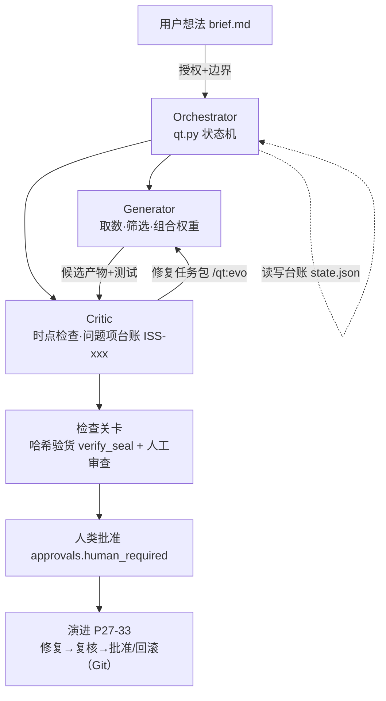

# qt-practice：长程智能体工作流 · 期末项目

> 复旦 FMBA《金融人工智能编程》期末作业
> 学号：25260660041 ｜ 姓名：崔捷
> 按课件 P4「完整架构」搭建的迷你量化研究工作流（迷你 Rogo）

## 工作流图（P4 骨架的实体化）


## 目录结构

| 路径 | 作用 | 课件页 |
|---|---|---|
| `kimi.plugin.json` + `commands/` | 插件命令 /qt:start、/qt:evo | P36 |
| `roles/generator.md` | Generator 角色契约 | P10 |
| `roles/critic.md` | Critic 角色契约（每轮全新审查） | P9 |
| `state/state.json` | 共享状态台账（产物哈希/问题项/批准权） | P14/P24 |
| `cases/case-001/` | 合成动量回测案例（种子42可复现） | P43/P44 |
| `cases/case-002/` | ETF 核心-卫星组合案例（真实数据） | 期末作业 |
| `evidence/` | 出生证明+目标权重+两份 Critic 审查报告 | P15/P19/P20 |
| `scripts/qt.py` | Orchestrator v3：验货审计+盖章+条件路由 | P14/P26 |
| `scripts/screen_etf.py` / `portfolio.py` | 筛选与组合权重（确定性可复跑） | 期末作业 |

## 如何复现

**case-001（合成数据，人人相同）：**
```bash
python3 scripts/make_data.py   # ① 生成合成数据（种子42）
python3 scripts/backtest.py    # ② 回测 → evidence/
python3 scripts/qt.py          # ③ Orchestrator：验货+盖章+路由
case-002（真实行情，取自 kimi-datasource，检索日期 2026-11-10）：
bash

复制
python3 scripts/screen_etf.py  # ① 按 brief 三条规则筛选卫星池
python3 scripts/portfolio.py   # ② 生成目标权重表 → evidence/portfolio-target.md
python3 scripts/qt.py          # ③ 验货+盖章+路由
注：case-002 原始行情需联网数据源，data/ 内快照已随仓库保存，可离线复跑。
案例结论
case-001：动量策略超额 +0.48%（99 次交易），扣费后预计转负；Critic 开 ISS-001~003。
case-002：动量规则自动完成"卖A股买美股"轮动；核心70%（510300/511010/518880）+ 卫星30%（VTI/SPY/QQQ/510880/511010 各6%）；Critic 开 ISS-004~005（台账残留、国债重复持仓）。
工程能力演示（恢复机制）
篡改检测：手改权重表数字 → qt.py 报 TAMPERED（审计证据链 P15）
一键恢复：git checkout -- 回滚 → 验货全绿
条件路由：status=pending → 自动分派 Generator 并翻转状态（P26）
已知边界（演进方向）
ISS-004/005 待修复（见 state.json 台账）
稳健性检验（多种子/子样本）待实现
自动 git push Hook（待安装）